# reSpotIt (Kotlin) — screen guide

Screenshots of every screen of the native Android client, captured from a real
device with the release build.

| | |
|---|---|
| Device | Xiaomi 2201117PG, Android 13, 1080 × 2400, 440 dpi |
| Build | `release` APK (`app-release.apk`), media-server mode against the local server (`https://192.168.1.11:8000`) |
| Captured | 2026-11-10 |
| App id | `com.spotifydashboard.app` |

All images live in [`screenshots/`](screenshots/).

---

## 1. Library

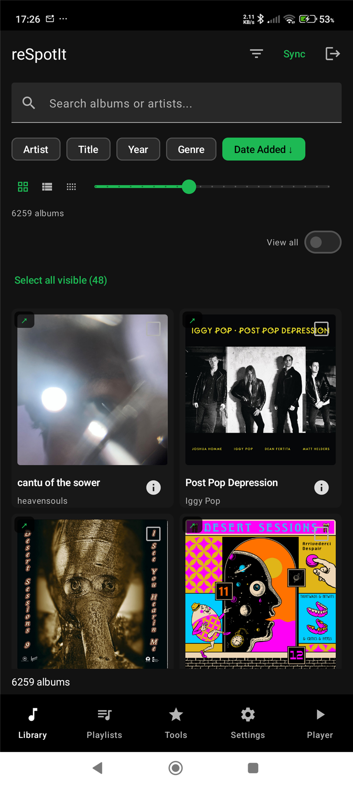

The default tab: your saved albums as a grid.

* Search field, then a filter row (artist, title, year, genre, date added).
* Grid / list / compact-grid switch and a grid-size slider.
* `6259 albums` counter with a **View all** toggle and **Select all visible**.
* Header shows the **Sync** button, the filter funnel and the account/logout action.
* Tapping an album's **Album tracks** button opens the track sheet (screen 3).

## 2. Filters

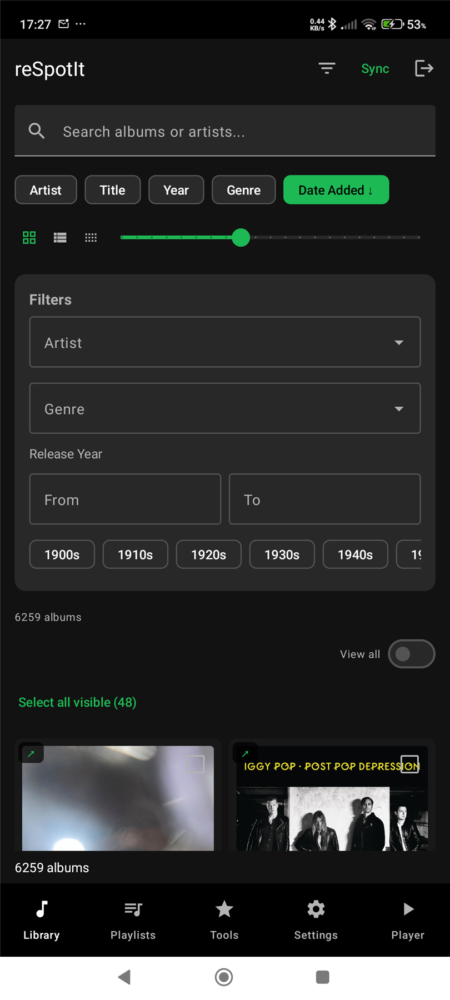

The filter funnel opens a panel with **artist**, **genre**, **release year**
(from/to plus decade shortcuts) and the same sort keys as the library header.
Filters apply immediately to the grid.

## 3. Album track sheet

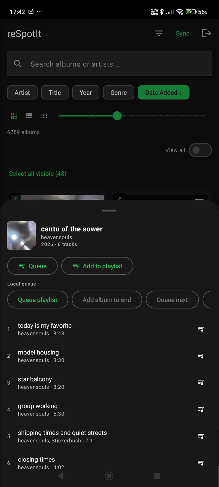

Bottom sheet for one album: cover, artist, year and track count.

* **Queue** and **Add to playlist** for the whole album.
* Local queue options: **Queue playlist**, **Add album to end**, **Queue next**.
* The track list shows the title, artist and play time; a track can be queued
  with the button on the right.

## 4. Playlists

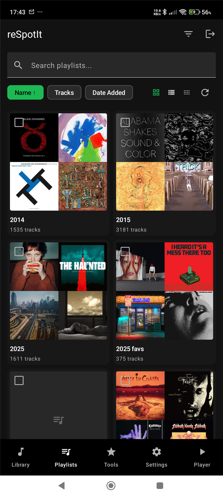

Your Spotify playlists with sortable columns (**Name**, **Tracks**, **Date
Added**), the track count per playlist and the search field. Opening a playlist
shows its albums with the per-playlist filters, CSV export and the retention
(expiry) picker.

## 5. Tools

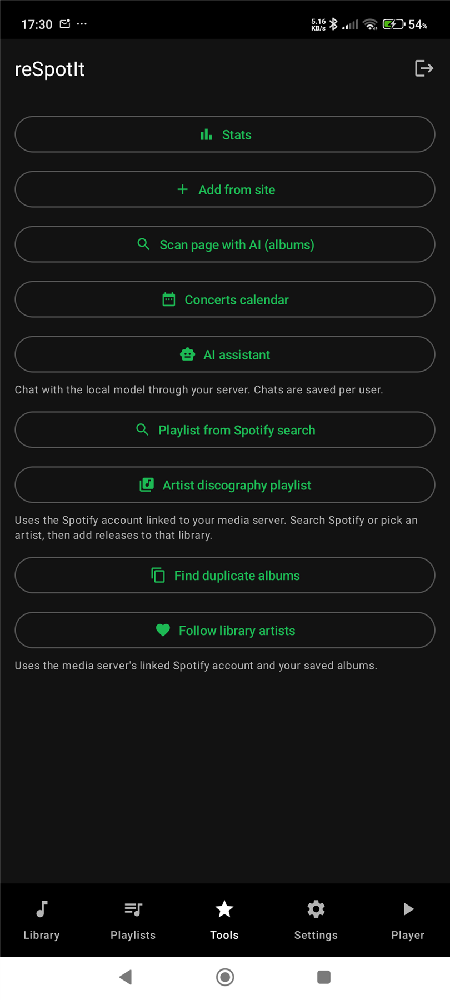

Everything that acts on your library:

| Button | What it does |
|---|---|
| **Stats** | Album / artist / genre counters, top genres, top artists, albums by year |
| **Add from site** | In-app browser that scrapes Spotify links from any page |
| **Scan page with AI (albums)** | AI album scan of any page (screen 12) |
| **Concerts calendar** | Month calendar of saved concerts (screen 6) |
| **AI assistant** | Chat with the local model through your server |
| **Playlist from Spotify search** | Search the Spotify catalogue and build a playlist |
| **Artist discography playlist** | Add an artist's releases to the library or a playlist |
| **Find duplicate albums** | Duplicate review (screen 11) |
| **Follow library artists** | Follow every artist in your library |

## 6. Concerts calendar

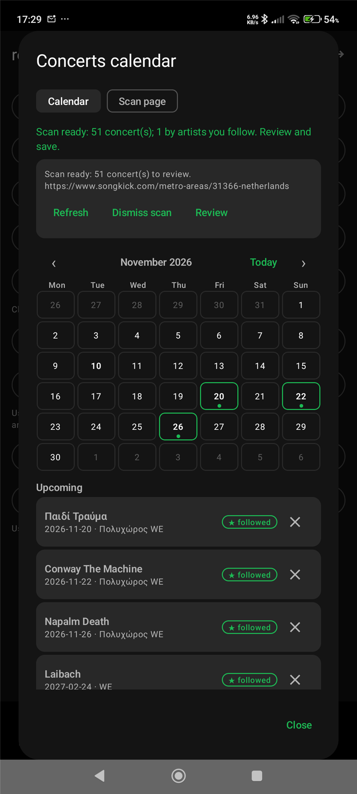

The saved concerts as a real calendar.

* Month grid (Monday-first) with ‹ / › navigation and a **Today** button.
* A day with concerts gets a green border and a dot; today is outlined.
* Below it, the concerts as **cards**: artist on the first line, date and venue
  on the second, a ★ badge for followed artists and a delete button.
* Sections: **Upcoming**, **Without a date** and **Past**.
* The dialog has two tabs — **Calendar** and **Scan page** — and a banner that
  appears on both when a scan is running or ready.

## 7. A day selected

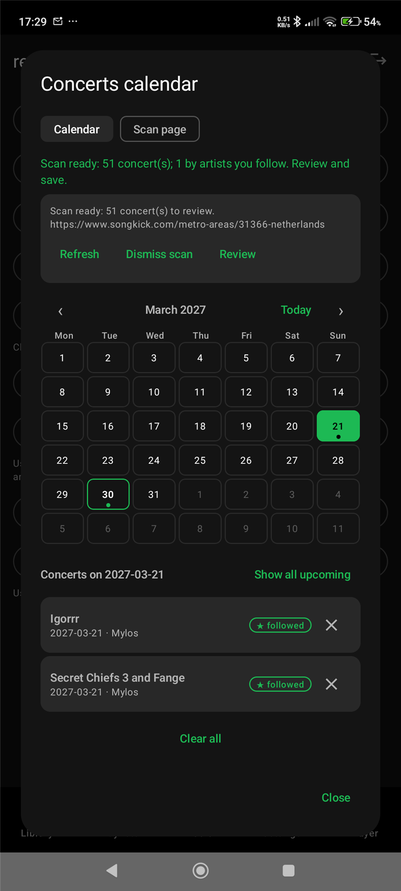

Tapping a day filters the list to that date ("Concerts on 2027-03-21") and
offers **Show all upcoming**. The month and the selected day survive closing
and reopening the sheet.

## 8. Concert scan

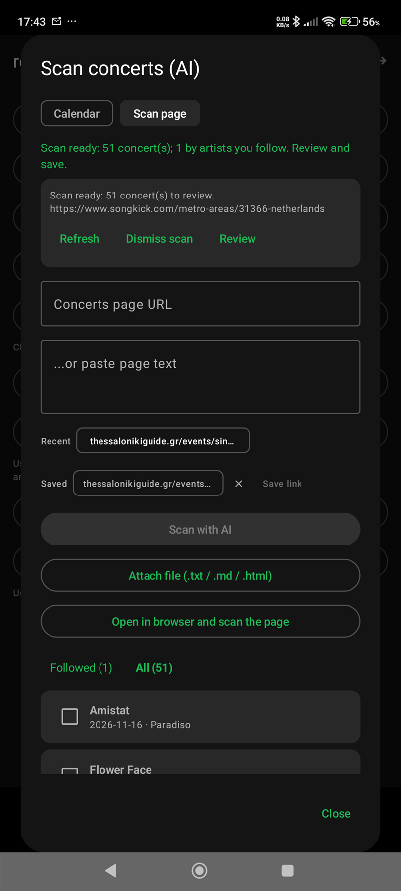

The **Scan page** tab: paste a concerts URL or text, or attach a file.

* **Scan with AI** starts a background scan on the server.
* **Open in browser and scan the page** loads the page in the in-app browser and
  snapshots the rendered DOM — the only way to read JS-built listings.
* Link history (recent / saved links) is one tap away.
* Results arrive as cards you tick and save; the Followed/All switch filters by
  artists you follow on Spotify.

## 9. Stats

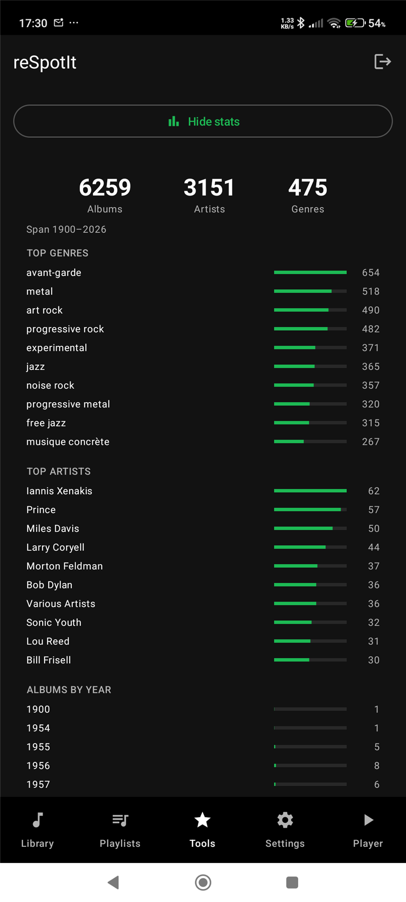

Library statistics from the server: totals (albums, artists, genres), the top
genres with bars, the top artists and the albums per year.

## 10. Stats breakdown

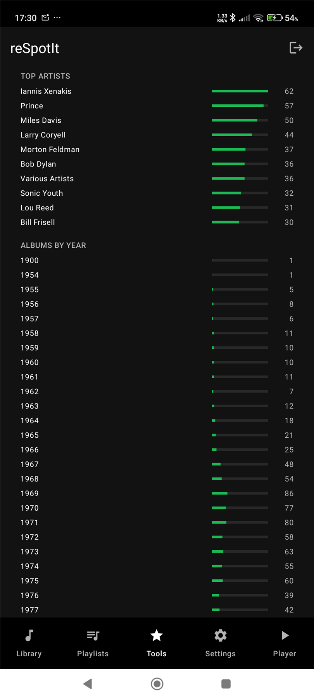

The same panel scrolled to the full **albums by year** histogram.

## 11. Duplicate albums

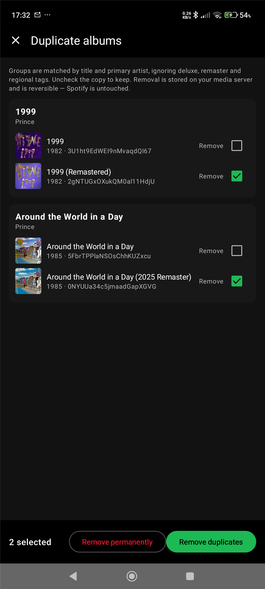

Duplicate review. Groups are matched by title and primary artist, ignoring
deluxe, remaster and regional tags. Uncheck the copy you want to keep — the
removal is stored on your media server and is reversible; Spotify is never
touched.

## 12. AI album scan

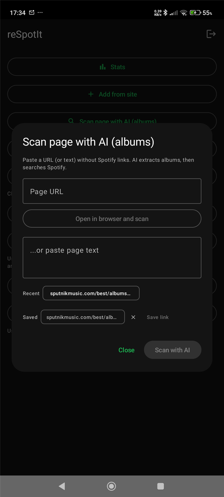

**Scan page with AI (albums)**.

* Paste a URL (or page text) of any chart or list — no Spotify links needed.
* **Open in browser and scan** loads the page in the app's own browser, then
  snapshots the rendered text and returns here with the URL preserved.
* The server chunks long pages, extracts `artist + album` pairs with the local
  LLM and resolves them against Spotify; the results can be saved to the
  library or turned into a playlist.

## 13. Add from site

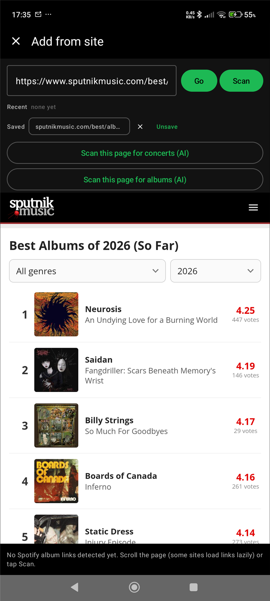

The in-app browser. It shows the URL bar with **Go** and **Scan**, the recent
and saved links, and the two page-snapshot buttons: **Scan this page for
concerts (AI)** and **Scan this page for albums (AI)**. The scan evaluates
`document.body.innerText` on the *rendered* page, so pages that build their
list with JavaScript work as well.

## 14. Settings

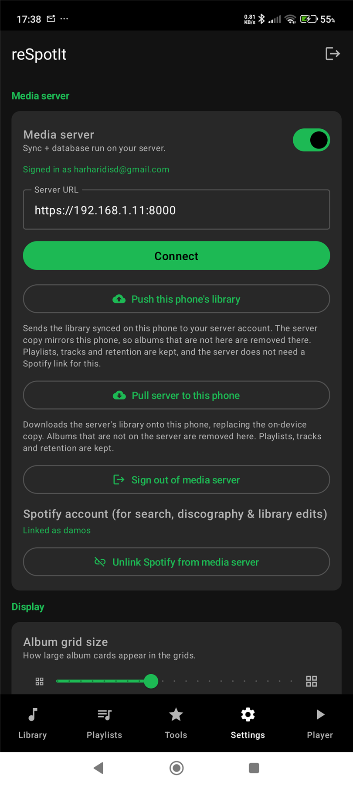

* **Media server** — server URL, sign-in, and the push/pull actions
  ("Push this phone's library", "Pull server to this phone").
* Backup (auto-backup and sub-folder), album grid size, sync photos.
* Autohide the bottom navigation / the search & sort bar.
* CSV import and export, hidden (duplicate) albums, playlist retention.
* Sign out.

## 15. Player

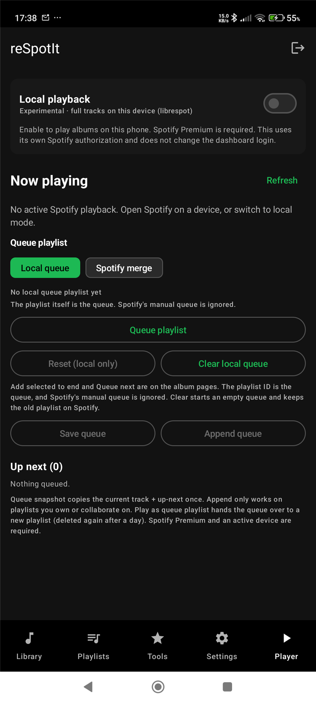

* **Local playback** — the experimental librespot player: full tracks on the
  device (Spotify Premium required, its own authorization, independent of the
  dashboard login).
* **Now playing** with a refresh and the active Spotify device.
* **Queue playlist** with the local queue and Spotify merge modes.

---

## Related documents

* [`../README.md`](../README.md) — setup, build, architecture, CI, troubleshooting.
* `docs/AI-TEXT-PIPELINE-PLAN.md` in the server repo — how the page scanning is
  implemented on the server.
* `EXPERIMENTAL_FEATURES.md` in the server repo — the feature status of every
  AI-driven screen.
